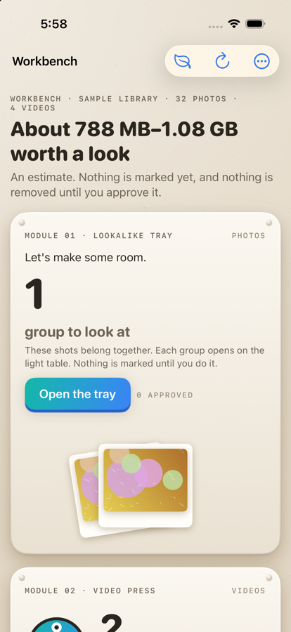
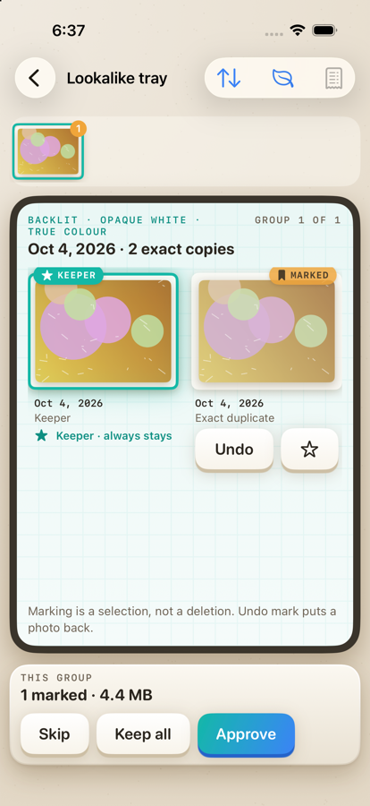

# PixelPare

A Mac and iPhone app that frees up iCloud Photos space. It finds lookalike photos, old screenshots and blurry
shots for you to review, and makes smaller HEVC copies of large videos at a level you pick (Gentle, Balanced or
Smaller resolution). Everything runs on the device, and the app reviews before it acts: it never deletes on its own.
An original video is only removed after its smaller copy has been imported, verified, and approved by you.

<p>
  
  
</p>

**Status:** v1 feature-complete and ready for hands-on testing on an iPhone with a real library (see
[Testing on iPhone](#testing-on-iphone-with-real-photos)). Not on the App Store yet.

## Features

| Tray | What it does |
|---|---|
| **Lookalikes** (light table) | Groups exact copies, near-identical and similar shots, then suggests a keeper with reasons ("Sharper", …). You approve each group. |
| **Video press** | Makes HEVC copies at Gentle / Balanced / Smaller resolution (≤ 1080p). Shows estimates and an A/B preview, then imports the copy with its date, location, favorite and albums kept. The original is removed only after you approve. |
| **Old screenshots** | Screenshots older than 30 days. |
| **Blurry shots** | Photos with low sharpness, shown as "probably blurry". Nothing is pre-marked. |
| **Receipt** | Reviews the plan before anything happens, then gives an honest recap afterwards. |

How it stays safe:
- Favorites are never removed, and every group keeps its keeper.
- Removals go to Photos' *Recently Deleted* and always need the system confirmation.
- The video pipeline is journaled, retried and resumable (see [docs/resilience.md](docs/resilience.md)).
- *Calm mode* turns off animation, sound and haptics.
- On iOS, gestures only mark or move items, never delete: swipe up/down to mark, swipe sideways between groups,
  long-press to peek, double-tap to make the keeper, and drag the compare divider.

## Testing on iPhone with real photos

**Before you start**
- Removed items go to *Recently Deleted* and can be recovered for 30 days. The exception: **if your iCloud storage is
  already full, deletes are immediate**. In that case, test on a small set first.
- Video compression downloads iCloud originals over **Wi‑Fi or cellular** by default, so mind your data plan. Turn off
  *Download videos over cellular* in Settings to make it wait for Wi‑Fi instead (Low Data Mode counts as
  metered too). It needs free space for the original plus the copy, with 1 GB to spare, and it pauses in Low
  Power Mode or when the phone is hot.
- A compression run you start keeps going when you leave the app (iOS shows system progress for it). iOS can still
  stop it, for example when the battery is low, the phone is hot or you cancel it there; the job then picks up where
  it stopped the next time you open the app. The screen stays awake while work is running in the foreground.

**Run it**
1. Connect the iPhone by cable (first time only), unlock it and tap *Trust*. On the phone, turn on
   **Settings → Privacy & Security → Developer Mode** and restart when asked.
2. `xcodegen generate` and open `PixelPare.xcodeproj`. Select the **PixelPare-iOS** scheme and your iPhone, then
   press **Run**. Signing is automatic with team `LDC68P74EM` (`project.yml`). If you fork the project, put your own
   team ID there. Xcode registers the phone and creates the profile on the first run.
   From the command line, once the phone is registered:
   ```sh
   xcodebuild -project PixelPare.xcodeproj -scheme PixelPare-iOS -destination 'platform=iOS,name=<your iPhone>' \
     -allowProvisioningUpdates build
   ```
3. On first launch, choose **Use the Photos library** and allow **Full access**. Limited access only sees the
   photos you picked.

**Suggested first session**
1. Let the first scan finish; large libraries take a few minutes, and later scans are cached. Open each tray and
   check the suggestions, without removing anything yet.
2. Approve **one** lookalike group and remove it. Confirm the photo is in *Recently Deleted* and the keeper is untouched.
3. In the Video press, pick **one** large H.264 video and use **Gentle**. When it says the copy is ready, check in
   Photos that the copy plays and has the right date, location and albums. Only then remove the original from the
   receipt.
4. Then try a batch. Kill the app mid-compression and reopen it: the job should offer to resume, with no duplicate copies.

Already-efficient HEVC, HDR / Dolby Vision, slow-motion, edited and short (< 3 s) videos are skipped on purpose. Most
recent iPhone footage is HDR (often Dolby Vision HEVC 10-bit). Videos already on the device are checked right
after the scan and moved to *Skipped*. For iCloud-only videos the format can only be read after download, so they
stay in the list and are skipped after downloading.

Developer launch arguments (Xcode → Scheme → Arguments):
- `--sample`: a built-in fake library that never touches Photos.
- `--folder <path>`: use a folder instead of Photos.
- `--screen lighttable|press|screenshots|blurry|receipt`: open that screen first.

## Known limitations

- **Background:** runs continue via `BGContinuedProcessingTask`, but the system may expire them; progress is kept
  and resumes next launch. Not available in the simulator.
- **Not built yet:** screen-recordings tray, biggest-items view, Live Photo → still, burst leftovers. See
  [docs/feature-ideas.md](docs/feature-ideas.md).
- **HDR videos** are never re-encoded (risk of losing Dolby Vision metadata).
- **Not transferable:** captions, People tags and shared-album membership can't be copied to a new video through
  Apple's public API.

## Layout

| Path | What |
|---|---|
| `Sources/PareCore` | Models, grouping, cleanup plan, operation journal |
| `Sources/PareVision` | Feature prints, blur and screenshot signals |
| `Sources/PareLibrary` | `PhotoLibrary` (PhotoKit) and `FolderLibrary` (dev / tests) |
| `Sources/PareTranscode` | HEVC transcoder, verifier, preview encoder, `EncoderGate` |
| `Sources/PareEngine` | Resilient, resumable video pipeline (export → encode → verify → import → approve → remove) |
| `Sources/PareUI` | Shared SwiftUI views and `AppModel` |
| `Apps/iOS`, `Apps/macOS`, `Apps/iOSUITests` | Thin app shells and UI tests. The Xcode project is generated from `project.yml` (XcodeGen). |
| `scripts/` | Test-video generator and SSIM scorer |
| `design/icon/` | App icon master `pixelpare-icon.svg`; `./make-icons.sh` builds the icon sets |

## Docs

| File | What |
|---|---|
| [docs/design.md](docs/design.md) | "Pocket Workshop" design: metaphor, delight moments, gestures, Calm mode |
| [docs/resilience.md](docs/resilience.md) | Video pipeline invariants, journal state machine, retries, recovery, tests, compression results |
| [docs/architecture.md](docs/architecture.md) | Original technical investigation: PhotoKit / Vision / AVFoundation constraints and risks |
| [docs/implementation-plan.md](docs/implementation-plan.md) | Module contracts and toolchain |
| [docs/feature-ideas.md](docs/feature-ideas.md) | Cleanup modules, built and planned |
| [docs/research.md](docs/research.md) | Competitors, Apple API constraints, realistic savings |

## Build

```sh
export DEVELOPER_DIR=/Applications/Xcode.app/Contents/Developer
swift build && swift test
xcodegen generate   # then open PixelPare.xcodeproj
```

UI tests (iOS Simulator, sample library only):

```sh
xcodebuild test -project PixelPare.xcodeproj -scheme PixelPare-iOS -destination 'platform=iOS Simulator,name=iPhone 17'
```

> **Real encode tests are opt-in.** Hardware VideoToolbox encodes from `swift test` have caused kernel panics on
> macOS 27.0.1 (see `docs/resilience.md` §9). Fixtures use Motion-JPEG, and the real HEVC suites run on Apple's
> *software* HEVC encoder:
>
> ```sh
> PIXELPARE_SOFTWARE_ENCODE=1 swift test --no-parallel --filter 'TranscoderTests|folderLibraryWithRealTranscoder'
> ```
>
> Compression on phone-like clips (every preset, with savings and an SSIM quality score):
>
> ```sh
> scripts/make-test-videos.sh          # ffmpeg (software x264/x265) → .scratch/videos
> PIXELPARE_SOFTWARE_ENCODE=1 PIXELPARE_TEST_VIDEOS=.scratch/videos PIXELPARE_TEST_OUTPUT=.scratch/video-output \
>   swift test --no-parallel --filter pipelineCompressesPhoneLikeClips
> scripts/score-test-videos.sh         # SSIM of each copy against its original
> ```
